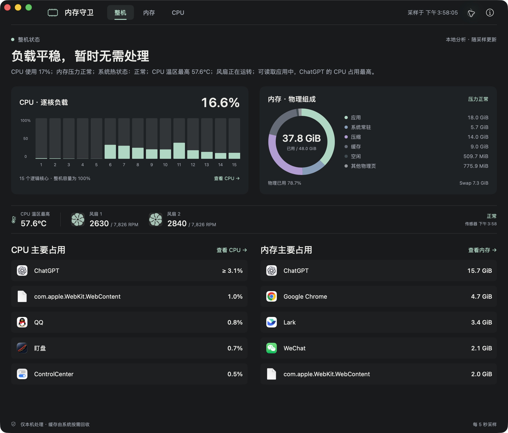
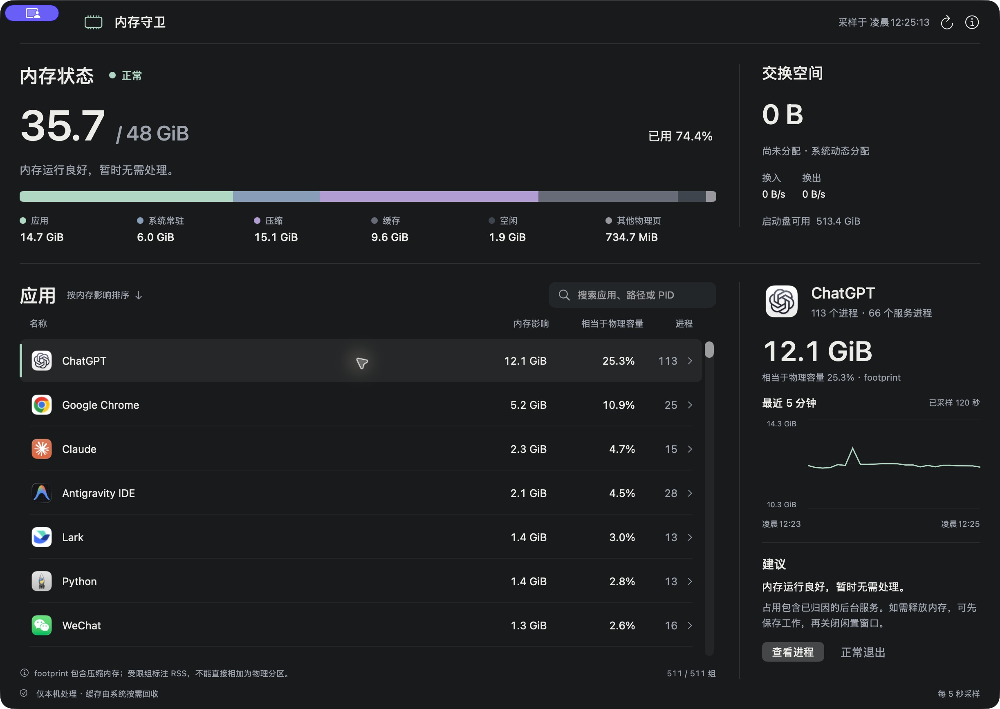
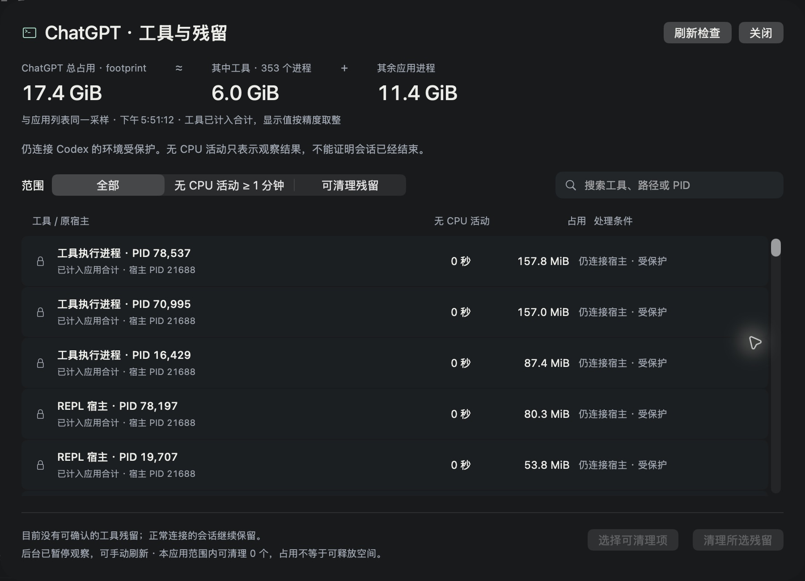

# MemoryGuardian（内存守卫）

macOS 原生 SwiftUI 内存与整机状态监控工具，重点解决 **AI Coding / MCP / Node 黑盒后台进程归因** 与 **闲置残留安全回收**。另附 C# / WPF 实现的 Windows 原生预览版（见 [windows/README.md](windows/README.md)）。

## 界面预览

| 整机状态与逐核/物理组成 | 应用内存与后台服务归因 |
| :---: | :---: |
|  |  |

| 工具子集口径拆解与安全回收面板 |
| :---: |
|  |

## 为什么要做这个工具

日常重度用 Codex / ChatGPT / Claude Code 等 AI 工具跑代码时，活动监视器里经常堆满几十上百个黑盒 `node` 进程。

有两点特别容易踩坑：

1. 用普通 `ps` 看某些 MCP 服务（比如 `wigolo`）的 RSS 只有几十 MiB，但系统内核通过 `proc_pid_rusage` 统计出来的真实 `ri_phys_footprint` 已经飙到 2~3 GiB，大部分页面被压进了内存压缩器。
2. 直接按“CPU 为 0”去 `kill` 后台 Node 进程很容易把正在连接的 MCP 会话搞断，下次调用直接报 `Transport closed`。

MemoryGuardian 主要围绕这两个实际问题来设计，只做本机只读观测与保守克制的手动回收。

## 核心能力

- **真实物理组成与口径隔离**：区分应用页、系统常驻、压缩内存、文件缓存与空闲内存，Swap 单列展示；应用侧优先采集 `ri_phys_footprint`，组内存在权限受限进程时整组切回 RSS 并标注，绝不混合累加。
- **Node / MCP 深度归因（`KERN_PROCARGS2` + 父链）**：
  - 仅读取内核参数区到 `argc` 为止，**绝不读取、展示或持久化环境变量及完整敏感参数**。
  - 自动处理 `npm exec` 改写的 `argv[0]`、`.bin` 软链路径、空格路径以及结合 `PROC_PIDVNODEPATHINFO` 解析相对入口脚本。
  - 沿单次采样快照的 `ppid` 链追溯到首个 `.app` 宿主，每 PID 只计入一次，应用详情页同步拆解“应用总占用 ≈ 工具进程 + 其余应用进程”。
- **保守的残留清理与闲置内核重置**：
  - 孤立工具残留需同时满足：本次运行已观察归属、原宿主已退出并由 `launchd`（PID 1）接管、无子进程、连续至少 60 秒无 CPU 时间增量，且发送 `SIGTERM` 前再次向内核核对 UID、`startTimeTicks`（防 PID 复用）和当前活动状态。
  - 针对配对的执行内核（`trusted-worker.js` / `kernel.js`），支持仅重置执行内核而保留宿主与 MCP 连接，需人工明确确认。
- **整机负载与普通用户只读 SMC 采集**：展示逻辑核心实时柱图、系统热状态（`ProcessInfo.thermalState`）以及 Apple Silicon（M1–M5）/ Intel 只读 SMC 温度与双风扇转速及硬件上限。
- **低开销节能调度**：前台窗口可见时每 5 秒（高压 3 秒）详细采样；切后台、遮挡或关窗后停掉进程与传感器扫描，仅保留每 30 秒一次的菜单栏系统摘要，休眠自动暂停。

## 构建、测试与打包

环境要求：macOS 14+，Swift 6.0 / Xcode Command Line Tools。

```bash
# 运行核心测试
swift test

# 开发运行
swift run

# 生成 release 构建、.app、zip 与 dmg
./scripts/package-macos.sh
```

说明：当前仓库脚本使用本地 ad-hoc 签名（`codesign --sign -`），未做 Apple Developer 公证；如需自己编译使用，首次打开若遇到系统未签名提示，需在系统“隐私与安全性”中放行，或自行配置签名证书。

## 当前边界与局限

- **只读与权限边界**：普通用户权限可以完整采集当前用户进程 footprint，其他系统用户进程会受限于权限并退回 RSS 展示。
- **运行时范围**：当前深度服务归因针对 Node / npm / npx 与 Codex 工具链实现，尚未泛化到 Bun、Deno、Python 等其他运行时。
- **不自动后台强杀**：不会在后台偷偷 `kill -9` 任何连接中的进程，避免误杀长耗时等待中的工具任务。
- **Windows 预览版**：位于 [windows/](windows/)，已具备内存概览、Node/WMI 归因与自检逻辑，未同步后续 macOS 的整机传感器与 Codex 内核重置面板。

## 目录结构

```text
Sources/MemoryGuardian/
├── MemoryGuardianApp.swift         # 应用入口与菜单栏 Scene
├── MemoryDashboardView.swift       # 主界面与系统内存页
├── MachineLoadView.swift           # 整机/CPU 页与负载汇总
├── MachineOverviewGridView.swift   # 整机双主图（逐核柱图 + 物理圆环）
├── CodexToolsView.swift            # 应用工具拆解与安全回收面板
├── MemoryMonitor.swift             # 状态聚合与节能采样调度器
├── SystemSampler.swift             # VM 页统计、rusage footprint 与父链归因
├── NodeAttribution.swift           # KERN_PROCARGS2 参数边界与 npm/脚本识别
├── CodexToolCleanup.swift          # 孤立残留观测与 5 道安全清理门禁
├── CodexKernelRecovery.swift       # 闲置执行内核配对观测与重置
├── LoadSampler.swift               # 逐核 CPU 与只读 AppleSMC 传感器
└── MachineTelemetrySampler.swift   # GPU / 电池 / 磁盘读写 / 网络速率采样
Tests/MemoryGuardianTests/          # 10 个测试套件（含真实系统采样与边界单测）
windows/                            # C# / WPF Windows 预览实现与核心单测
scripts/                            # macOS / Windows 构建打包脚本
```

## 关于作者与更多工具

我是独立开发者 guuguo，日常重度使用 AI 辅助开发，顺手把踩到的高频痛点做成了开源小工具。

- 个人工具矩阵主页：[hub.guuguo.top](https://hub.guuguo.top/)（macOS 工具集：[hub.guuguo.top/mac-utils](https://hub.guuguo.top/mac-utils)）
- 同系列工具：[Agent Control](https://github.com/guuguo/agent-control) · [Antigravity 多语言](https://github.com/guuguo/antigravity-zh-launcher) · [MenuBarTidy](https://github.com/guuguo/MenuBarTidy)
- GitHub 主页：[@guuguo](https://github.com/guuguo)
- 技术博客（掘金）：[guuguo 的掘金主页](https://juejin.cn/user/835284564728573)

## License

[MIT](LICENSE)
